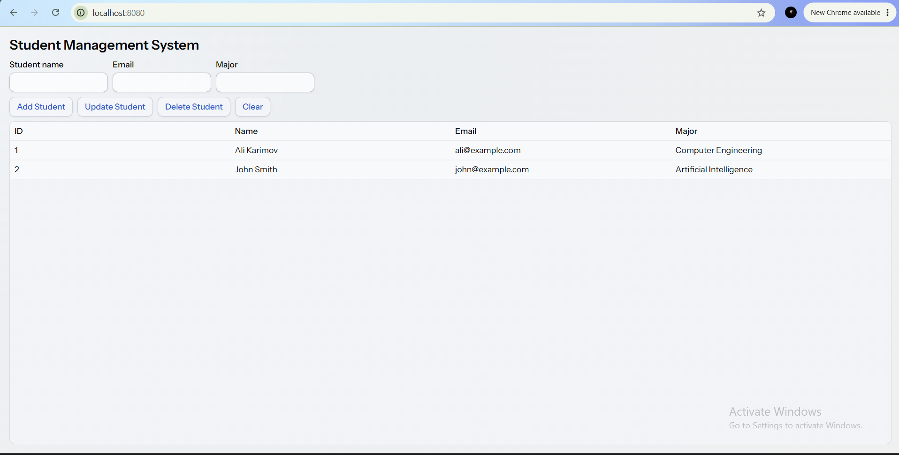
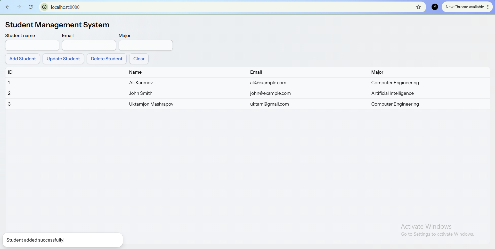
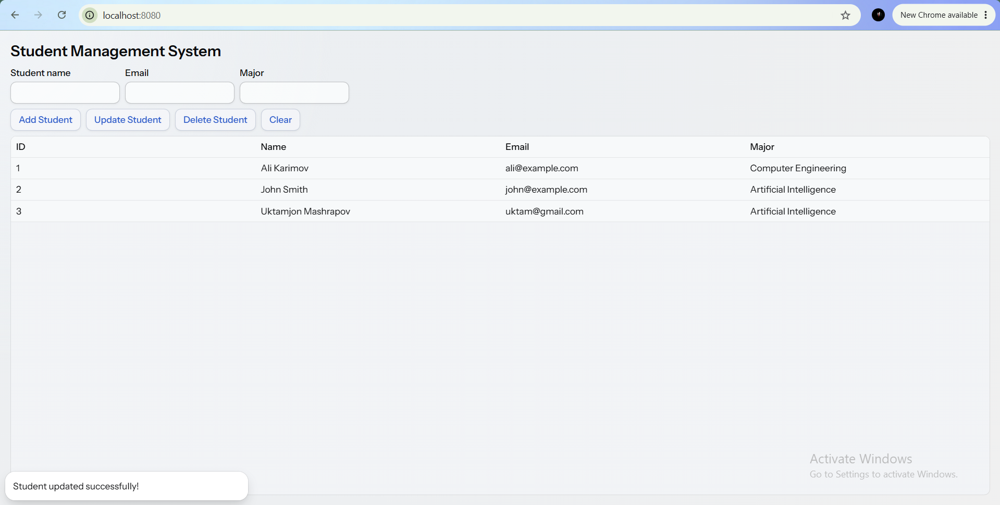
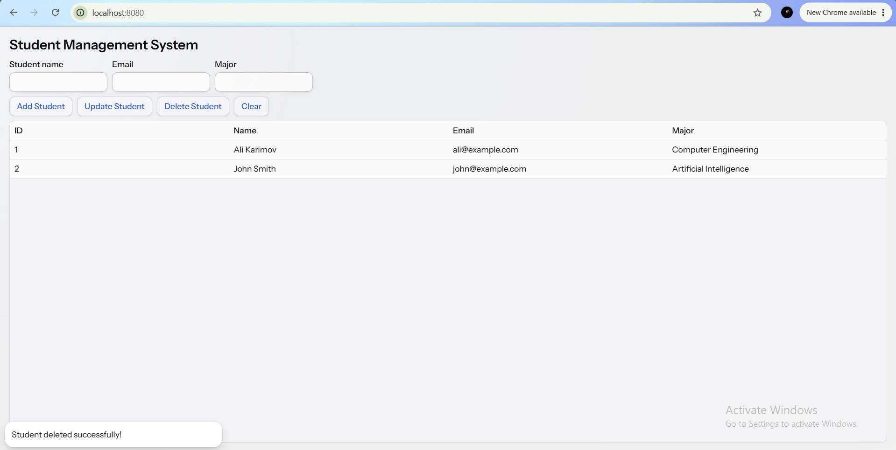
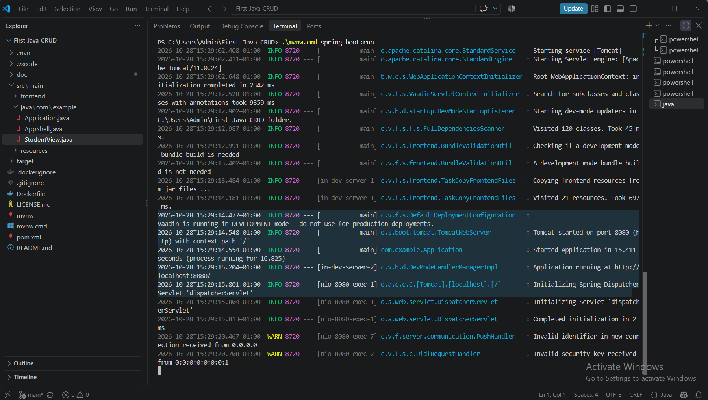

# Student Management System

A web-based Student Management System built with Java, Spring Boot, and Vaadin. The application provides a simple interface to manage student records using CRUD operations.

## Features

* **Create:** Add a new student with a name, email, and major.
* **Read:** View student records in a table.
* **Update:** Select a student and modify their information.
* **Delete:** Remove a student record.
* **Clear:** Clear the form fields.

## Technologies Used

* Java
* Spring Boot
* Vaadin
* Maven

## Requirements

* Java Development Kit (JDK)
* Maven Wrapper (included in this repository)

## How to Run

1. Clone or download this repository.

2. Open a terminal in the project directory.

3. Run the application on Windows:

   ```powershell
   .\mvnw.cmd spring-boot:run
   ```

4. Open your browser and visit:

   http://localhost:8080/

To stop the application, press `Ctrl + C` in the terminal.

## Screenshots

### Application Running



### Create Student



### Update Student



### Delete Student



### Application Startup Logs



## Notes

Student records are stored in memory. They may be lost when the application restarts.

## License

See the [LICENSE](LICENSE) file for license information.
